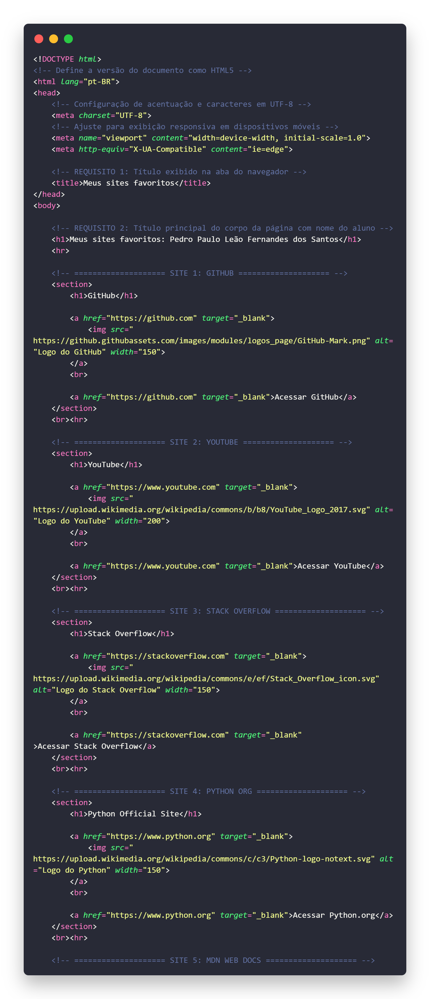
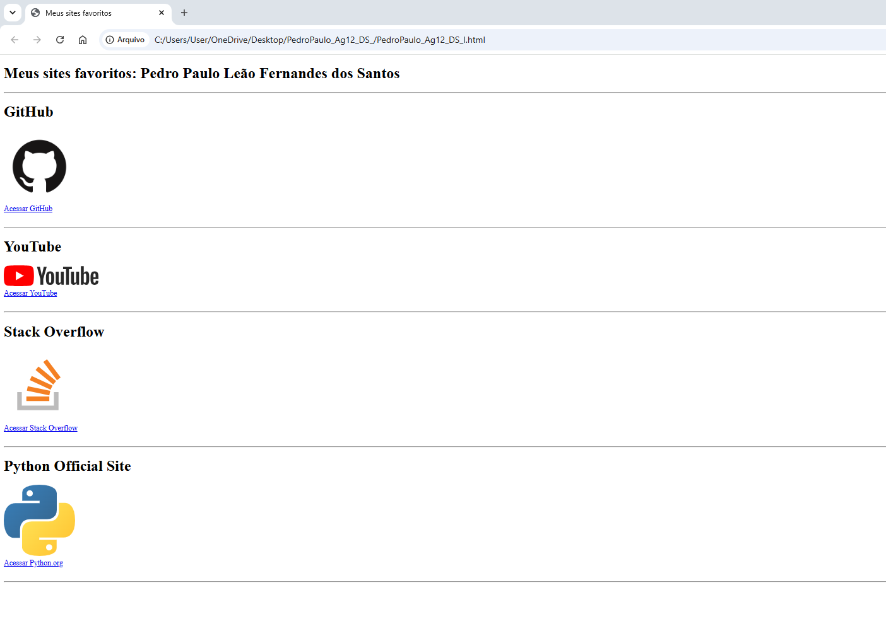

# 🌐 Meus Sites Favoritos - Agenda 12 (DS I)

Projeto de página web estática em HTML5 desenvolvido para guardar sites favoritos de estudo e entretenimento.

Projeto entregue para a **Agenda 12 - Desenvolvimento Web I** do curso de **Desenvolvimento de Sistemas (ETEC)**.

---

## 📌 Requisitos Atendidos

- **Título na Aba (`<title>`):** `Meus sites favoritos`
- **Título do Corpo (`<h1>`):** `Meus sites favoritos: Pedro Paulo Leão Fernandes dos Santos`
- **5 Sites Cadastrados:**
  1. **GitHub** (`https://github.com`)
  2. **YouTube** (`https://www.youtube.com`)
  3. **Stack Overflow** (`https://stackoverflow.com`)
  4. **Python.org** (`https://www.python.org`)
  5. **MDN Web Docs** (`https://developer.mozilla.org`)
- **Imagens e Links:** Cada site possui o seu nome em `<h1>`, imagem indicativa e link direto via tag `<a>` abaixo e sobre a própria imagem.

---

## 📁 Capturas de Tela

| Código Fonte (Snapcode) | Execução no Navegador |
| :---: | :---: |
|  |  |

---

## 👤 Autor

**Pedro Paulo Leão Fernandes dos Santos**  
Estudante de Desenvolvimento de Sistemas — ETEC.
